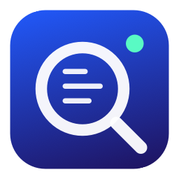
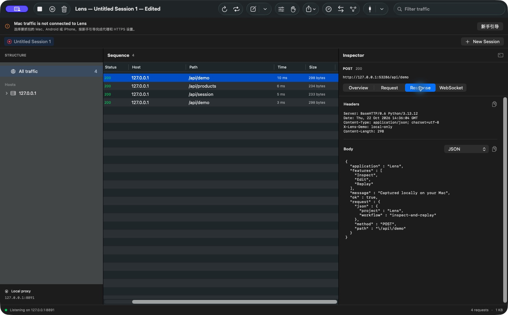
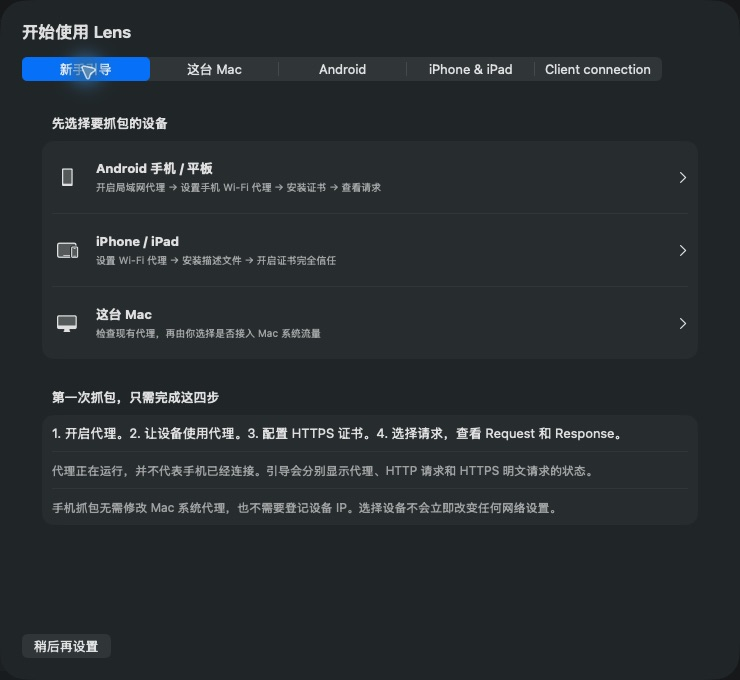

<p align="center"></p>
<h1 align="center">Lens</h1>
<p align="center"><strong>看清请求，读懂响应。</strong><br>使用 SwiftUI 与 mitmproxy 构建的原生 macOS HTTP / HTTPS 抓包工具。</p>
<p align="center"><a href="README.md">English</a> · <a href="https://github.com/CauT/lens-proxy/releases">下载预览版</a> · <a href="docs/guide/usage.md">使用说明</a> · <a href="CONTRIBUTING.md">参与贡献</a></p>



Lens 将请求检查、流量修改和手机代理抓包放进原生 Mac 工作区。可以检查头部与
正文、编辑断点、映射地址、重放请求，并保存多会话工作区。处理在本地进行，
无需账号或云端抓包服务。分享抓包、截图前请检查并脱敏。

> **早期预览版。** Apple Silicon DMG 使用临时签名，尚无 Developer ID 签名或
> Apple 公证，macOS 可能阻止打开。打包检查保证文件完整性，不代表 Gatekeeper
> 验收通过。也可自行构建源码。当前不提供已验证的 Intel 二进制。

## 功能

- **检查**：HTTP / HTTPS、域名路径导航、搜索、独立 Request / Response 面板。
- **读正文**：JSON、XML、文本、Hex、表单、Multipart、WebSocket、无 schema 的 Protobuf。
- **改流量**：Rewrite、Map Local / Remote、DNS 映射、URL 黑白名单、可编辑断点。
- **复现**：Compose、Replay、Repeat；在会话中保留请求结果。
- **保存**：多会话、工作区、HAR 导入导出、正文和 CSV 导出。
- **连接手机**：Android / iPhone / iPad 引导、按次启用的 LAN、公有 CA 下载。

Lens 是独立项目，与 Charles 无隶属关系，不包含其实现、图像或证书，不承诺完全兼容。

## 第一次抓包

1. 从 [Releases](https://github.com/CauT/lens-proxy/releases) 下载 DMG，核对签名说明和 SHA-256。
   打开磁盘映像，将 **Lens.app 拖到 Applications**，推出映像后打开 Lens。
2. 打开 **Connection → 新手引导**，选择这台 Mac、Android 或 iPhone / iPad。
3. 先验证 HTTP。Mac 抓包需要明确选择当前网络服务并点 **Use Lens for this service**，
   或为单个客户端配置代理。只启动端口不等于已经接入浏览器流量。
4. 抓 HTTPS 前，在客户端安装并信任**当前 Mac 的 Lens 公有 CA**，配置 SSL hosts。
   选中新请求，分别检查 Request 和 Response 的头部与正文。
5. 结束后 Stop / Quit。Lens 恢复仍由自己管理的 Mac 代理；手机 Wi-Fi 代理需手动关闭。

已有 Clash / VPN 时先核对路由，可在 **Network → HTTP upstream proxy** 配置现有
HTTP 上游。手机抓包不需要接管 Mac 系统代理。

### Android 五步设置

1. 手机与 Mac 接入同一可互通网络。
2. **Connection → Android** 中停止当前监听，启用 LAN，选择 Mac IP / 端口，保存并启动。
   无需手机白名单，LAN 每次启动默认关闭。
3. 手机 Wi-Fi 的代理选“手动”，服务器填 Mac IP，端口填 Lens 显示值，不加 `http://`。
4. 浏览器打开 **`http://lens.invalid/`**，与 Mac 核对 CA 指纹，下载后作为 **CA 证书**安装。
5. 打开 HTTPS 网页，在 Lens 检查 Request / Response 正文；只有 CONNECT 不算解密成功。



Android“网络可能受到监控”的提醒与浏览器阻止访问的证书错误不同。
HTTP 页面能打开仅证明代理连通。换 Mac 或重建 CA 后需重新核对指纹。
现代 App 可能拒绝用户 CA；Lens 不绕过证书固定。
[完整 Mac / Android / iOS 说明和排错](docs/guide/usage.md)。

## 从源码构建

需要 macOS 14+、Apple Command Line Tools 和已安装的 [uv](https://docs.astral.sh/uv/)。
无需完整 Xcode，独立 Python 与依赖保存在项目内，并随 App 打包。

```sh
git clone https://github.com/CauT/lens-proxy.git
cd lens-proxy
bash scripts/bootstrap.sh
bash scripts/build-app.sh
open Lens.app
```

[开发与测试](docs/guide/development.md) · [DMG 发布流程](docs/guide/releasing.md)。

当前不支持 HTTP/3 解码、AMF、有 schema 的 gRPC / Protobuf、Charles 私有会话格式。
代理不等于 VPN，不保证所有 App 使用代理。[抓包容量与存储](docs/guide/usage.md#limits-and-storage)。

欢迎提交已脱敏、可复现的 [Issue](https://github.com/CauT/lens-proxy/issues) 或按
[贡献指南](CONTRIBUTING.md) 改进项目。采用 [MIT](LICENSE)，依赖保留各自许可，
见[第三方声明](THIRD_PARTY_NOTICES.md)。
