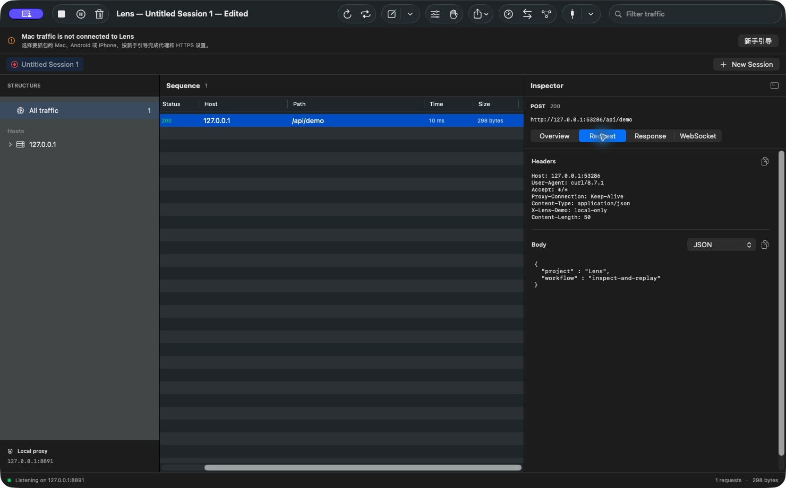

# Using Lens

## Mac

Open **Connection → Get Started → This Mac**. Confirm the listener is ready, review
the active service and existing proxy settings, then explicitly select **Use Lens
for this service**. Alternatively use manual clients only. Some applications
ignore system proxies. An empty request list does not prove an engine failure.

For HTTPS, reveal the **public** CA in Connection, verify its fingerprint, and
manually import/trust it on the client. On macOS use the intended keychain's SSL
trust settings. Lens never silently trusts a CA. **SSL hosts** chooses targets:
`*` for all proxied hosts, empty for encrypted tunneling. Changes affect new connections.

Pause recording keeps forwarding; Stop closes listeners while retaining details.
Quit releases the engine. Lens restores only proxy settings it still owns and
does not overwrite externally changed settings. Before replacing Clash or another
route, configure an explicit HTTP upstream under Network if needed. PAC,
authenticated upstreams and arbitrary VPN coexistence are not automatic.

## Android

1. Put Mac and phone on the same reachable network.
2. In **Connection → Android**, stop if needed, enable LAN for this launch,
   select the Mac LAN IPv4/port and save/start. No phone IP registration.
3. Set the phone's Wi-Fi manual proxy to that IP/port, without `http://`.
   Both HTTP and HTTPS use the same port. `127.0.0.1` means the phone itself.
4. Open `http://lens.invalid/` with **http**, compare its fingerprint with the
   connected Mac, download and install as an Android **CA certificate**.
   A Wi-Fi/client identity installer category is different. Verify the installed
   fingerprint, not merely its `mitmproxy` name; different Macs generate different CAs.
5. Open an HTTPS page, select its record and inspect Request and Response bodies.
   Only CONNECT is not success. Turn the phone proxy off after testing.

LAN starts disabled each app launch. Every device able to reach the enabled
address can connect. Use an appropriate network and remove unneeded test CAs.
Modern apps may need [debug user-CA trust configuration](https://developer.android.com/privacy-and-security/security-config#TrustingDebugCa).
A browser success does not establish all-app support; pinned apps may reject capture.

## iPhone and iPad

Use **Connection → iPhone & iPad** with the same LAN setup. On the device choose
Wi-Fi → current network → Configure Proxy → Manual; set Mac IP/port and leave
authentication off. In Safari open `http://lens.invalid/`, verify the fingerprint
and download the CA. Install the downloaded profile under General → VPN &
Device Management, then enable full trust under General → About → Certificate
Trust Settings. Profile installation alone is insufficient.
[Apple instructions](https://support.apple.com/en-us/102390).
Physical iOS-device acceptance is not claimed by the initial preview.

## Inspect, edit and save

JSON bodies now offer a collapsible Tree, colored Pretty text with line numbers,
original Source, key/value search, and exact value/JSON Pointer copying.
See the [JSON reading guide](json-viewer.md) for controls and edge cases.

Select records and inspect both sides independently. Choose Text, JSON/XML, Hex,
forms or Multipart as appropriate. Binary content remains binary; viewer limits
do not imply body-export truncation. WebSocket messages have their own view.

Rules support rewrite, Map Local/Remote, DNS mapping and request/response
breakpoints. Edit a paused message, continue unchanged or abort; deadlines bound
the pause. Compose, Replay and Repeat issue real new requests: check destinations
and payloads before repeating side effects.

New Session separates capture rooms. Save Workspace preserves all sessions;
HAR export is session-local. Body/CSV exports, autosave and response mirroring
write local files at chosen destinations. Clear/Close offer save-copy choices.
Named workspace saves are the durable handoff; Stop's private retained snapshot
is overwritten on a later successful Stop.

## Troubleshooting

| Symptom | Check |
| --- | --- |
| Listener ready, no Mac traffic | Actual system/client proxy, recording and filters; some apps ignore proxies |
| Phone HTTP setup fails | Same network, correct IP/port, LAN enabled, firewall/local-network permission, Wi-Fi client isolation |
| HTTP works, HTTPS blocked | Installed CA fingerprint/category, device clock, browser trust policy and SSL hosts |
| Android says network may be monitored, pages load | Installed-user-CA notice; distinct from TLS failure ([Android requirement](https://android.googlesource.com/platform/compatibility/cdd/+/master/9_security-model/9_8_privacy.md)) |
| Browser works, an app fails | App may reject user CAs, ignore proxies or pin certificates |
| Certificate fails after changing Macs | Same display name does not mean same fingerprint |
| Download blocked by macOS | Initial preview lacks Developer ID/notarization; see release notes/source build |
| Detail cannot load | Read the explicit error and Retry; report sanitized reproduction if it persists |

For certificate issues include browser/OS version, affected hostname and exact
warning or a redacted screenshot. Never bypass TLS warnings to claim a pass.

## Limits and storage

Settings and the CA are under `~/Library/Application Support/Lens/`. This includes
a **private signing key**: distribute only the public CA. Captures, snapshots
and exports may contain credentials. Lens has no hosted capture service.

HTTP retention: 2,000 requests / 256 MiB body bytes; single HTTP body: 32 MiB.
Inspector previews: up to 2 MiB per side with explicit truncation. WebSocket
retention, HAR file size and metadata have separate bounds. These are capture
budgets, not maximum process RSS guarantees. Old nonpaused requests can be
evicted; save important evidence before long captures.
